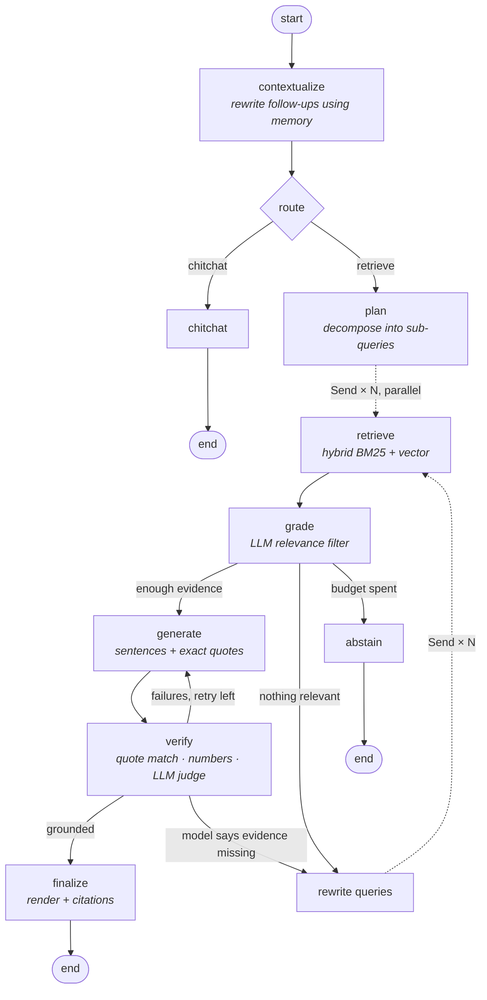

# 📎 Grounded RAG Agent

An agentic Retrieval-Augmented Generation system, built with **LangChain + LangGraph**, where every
sentence of every answer is backed by a **verbatim quote that is verified in code** before the user
sees it.

> **New here? Start with [`LEARNING_PLAN.md`](LEARNING_PLAN.md)**: a detailed 3-day curriculum that takes
> you from "what is an embedding?" to this whole system, with exercises and checkpoints.
> Theory and interview prep live in [`docs/CONCEPTS.md`](docs/CONCEPTS.md).

## Why this project is interesting

Most RAG demos ask the model to "cite your sources" and trust whatever `[1]` it prints. That fails
in quiet ways: citations that point to the wrong chunk, quotes that were never in the source, and
right quotes attached to wrong numbers. This agent treats citations as **claims to be checked**:

| Layer | What it does | Where |
|---|---|---|
| Hybrid retrieval | BM25 + embeddings fused with weighted RRF, optional cross-encoder rerank | `retrieval.py` |
| Query planning | Splits multi-part questions into sub-queries, searched **in parallel** | `graph/nodes.py: plan` |
| Corrective retrieval | LLM grades each chunk; irrelevant ones are dropped; re-search if nothing useful | `grade`, `rewrite` |
| Structured citations | Model must return `{sentence, source_id, exact quote}` via Pydantic schema | `schemas.py` |
| Mechanical verification | Source exists? Quote in source (exact/fuzzy)? Numbers in claim present in quote? | `grounding.py` |
| Semantic verification | LLM judge: do the quotes actually *entail* the claim? | `grounding.py: judge_reports` |
| Self-repair | Verification failures are fed back to the model for another attempt | `verify → generate` loop |
| Honest abstention | No evidence → says so instead of guessing | `abstain` |
| Memory | Multi-turn chat; follow-ups rewritten into standalone questions | checkpointer + `contextualize` |

## Architecture



Example (from the test-suite, scripted LLM): the first draft cited a quote that isn't in the source,
the verifier caught it, and the repair pass fixed it:

```
contextualize: question is standalone
route: retrieve (needs documents)
plan: 3 queries -> ['Compare LFP and Betz', 'LFP chemistry', 'Betz limit']
retrieve('Compare LFP and Betz'): 4 chunks
retrieve('LFP chemistry'): 4 chunks
retrieve('Betz limit'): 4 chunks
grade (round 1): 7/7 new chunks relevant; 7 evidence chunks total
generate (attempt 1): 2 sentences, insufficient=False
verify: 1/2 sentences grounded (50%)
generate (attempt 2): 2 sentences, insufficient=False
verify: 2/2 sentences grounded (100%)
finalize: 2 sources cited

LFP is safer and lasts for more charge cycles.[1] A turbine can capture at most 59.3 percent of wind energy.[2]
[1] battery_storage.md, § Battery Storage
    "it is safer and lasts for more charge cycles than nickel-based chemistries"
[2] wind_power.md, § Wind Power
    "no wind turbine can capture more than 59.3 percent of the kinetic energy in wind"
```

## Quick start

```bash
python -m venv .venv && source .venv/bin/activate      # Windows: .venv\Scripts\activate
pip install -e ".[anthropic,local,ui,dev]"             # or ".[all]"
cp .env.example .env                                   # add your API key (or configure Ollama)

pytest -q                                              # 28 offline tests, no API key needed
grag ingest data/docs                                  # index the sample corpus (md, pdf, html)
grag ask "Compare the round-trip efficiency of batteries and hydrogen" -v
grag chat                                              # multi-turn with memory
streamlit run app/streamlit_app.py                     # web UI
uvicorn grounded_rag.api:app --reload                  # REST API → http://localhost:8000/docs
python eval/run_eval.py --compare                      # ablation study
```

**Free, fully local option:** install [Ollama](https://ollama.com), then
`ollama pull llama3.1:8b && ollama pull nomic-embed-text`, and in `.env` set
`GRAG_LLM_PROVIDER=ollama`, `GRAG_LLM_MODEL=llama3.1:8b` (embeddings can stay on `huggingface`).
Small models follow the citation format less reliably; you'll see the repair loop working hard.

**First run note:** `huggingface` embeddings download `all-MiniLM-L6-v2` (~90 MB) once.

## Project layout

```
grounded-rag-agent/
├── LEARNING_PLAN.md          ← the 3-day curriculum
├── docs/CONCEPTS.md          ← theory, design decisions, interview Q&A
├── from_scratch/             ← Part 1: the same idea in ~500 lines of plain Python (no frameworks)
├── src/grounded_rag/
│   ├── config.py             all knobs (env vars with GRAG_ prefix)
│   ├── models.py             LLM + embedding factories (init_chat_model)
│   ├── documents.py          PDF / Markdown / text / HTML loaders → Documents
│   ├── ingestion.py          chunking, stable chunk ids, sections, IndexManager (Chroma / in-memory)
│   ├── retrieval.py          BM25 retriever, EnsembleRetriever (RRF), cross-encoder reranker
│   ├── schemas.py            Pydantic schemas for structured output
│   ├── prompts.py            every prompt, in one place
│   ├── grounding.py          verification, LLM judge, rendering, highlighting
│   ├── graph/
│   │   ├── state.py          graph state + reducers
│   │   ├── nodes.py          node functions and routers
│   │   └── builder.py        wiring (StateGraph, Send, RetryPolicy, checkpointer)
│   ├── service.py            RAGService, the one object everything uses
│   ├── api.py                FastAPI (incl. SSE streaming)
│   └── cli.py                `grag` command
├── app/streamlit_app.py      chat UI with live steps + highlighted evidence
├── eval/                     dataset (16 Qs incl. comparisons, unanswerable, false premise) + harness
├── tests/                    28 offline tests with a scripted fake LLM
├── data/docs/                sample corpus (synthetic sample data, not authoritative)
└── Dockerfile, docker-compose.yml, Makefile
```

## Configuration

All settings live in `src/grounded_rag/config.py` and can be overridden with environment variables
(`GRAG_` + upper-case name) or `.env`.

| Setting | Default | Effect |
|---|---|---|
| `LLM_PROVIDER` / `LLM_MODEL` | `anthropic` / `claude-haiku-4-5-20251001` | any `init_chat_model` provider |
| `EMBEDDING_PROVIDER` / `EMBEDDING_MODEL` | `huggingface` / `all-MiniLM-L6-v2` | `openai`, `ollama`, `fake` (tests) |
| `VECTOR_STORE` | `chroma` | `memory` = rebuilt from `chunks.jsonl` each start |
| `CHUNK_SIZE` / `CHUNK_OVERLAP` | 800 / 120 | characters |
| `TOP_K` / `FETCH_K` | 5 / 20 | final chunks per query / candidates before fusion |
| `BM25_WEIGHT` | 0.4 | keyword weight in fusion (dense gets the rest) |
| `USE_RERANKER` | false | cross-encoder rerank (needs `sentence-transformers`) |
| `MAX_SUB_QUERIES` | 4 | query decomposition width (0 = only the original question) |
| `MAX_RETRIEVAL_ROUNDS` | 2 | corrective re-search budget |
| `MAX_GENERATION_ATTEMPTS` | 2 | repair loop budget |
| `MIN_GROUNDING` | 0.99 | below this, repair |
| `USE_JUDGE` | true | LLM entailment check |
| `QUOTE_MATCH_THRESHOLD` | 90 | fuzzy match score (0-100) for quotes |

Observability: set `LANGSMITH_TRACING=true` and `LANGSMITH_API_KEY` to see every node, prompt,
and token count in LangSmith; no code changes needed.

## API

| Method | Path | Body | |
|---|---|---|---|
| GET | `/health` | | status + chunk count |
| GET | `/sources` | | indexed files |
| POST | `/ingest` | multipart `files` | upload & index |
| DELETE | `/sources/{name}` | | remove a file's chunks |
| POST | `/search` | `{query, k, mode}` | retrieval only |
| POST | `/chat` | `{question, thread_id?}` | full answer + citations + trace |
| POST | `/chat/stream` | `{question, thread_id?}` | Server-Sent Events, one per graph node |
| GET | `/threads/{id}/history` | | conversation memory |

```bash
curl -s localhost:8000/chat -H 'content-type: application/json' \
     -d '{"question":"What is the duck curve?","thread_id":"me"}' | jq .answer
```

## Known limitations (good things to improve and write about)

Several limitations are worth knowing about:

- Memory uses `InMemorySaver`, so conversations vanish on restart. Swap in `SqliteSaver` or `PostgresSaver`.
- `memory` vector store re-embeds on each start; use Chroma for anything real.
- PDF tables and images are flattened to text; scanned PDFs need OCR.
- The LLM judge costs one extra call per answer. An NLI model is a cheaper alternative.
- Quote verification proves the words exist in the source, and the judge checks entailment, but
  neither can catch a source that is itself wrong.
